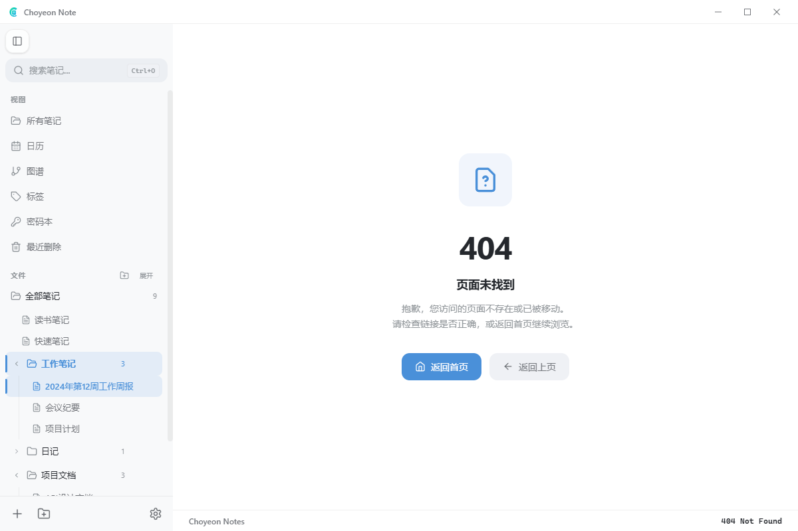
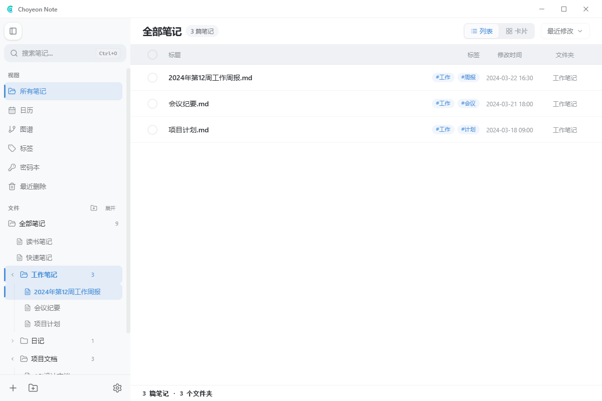
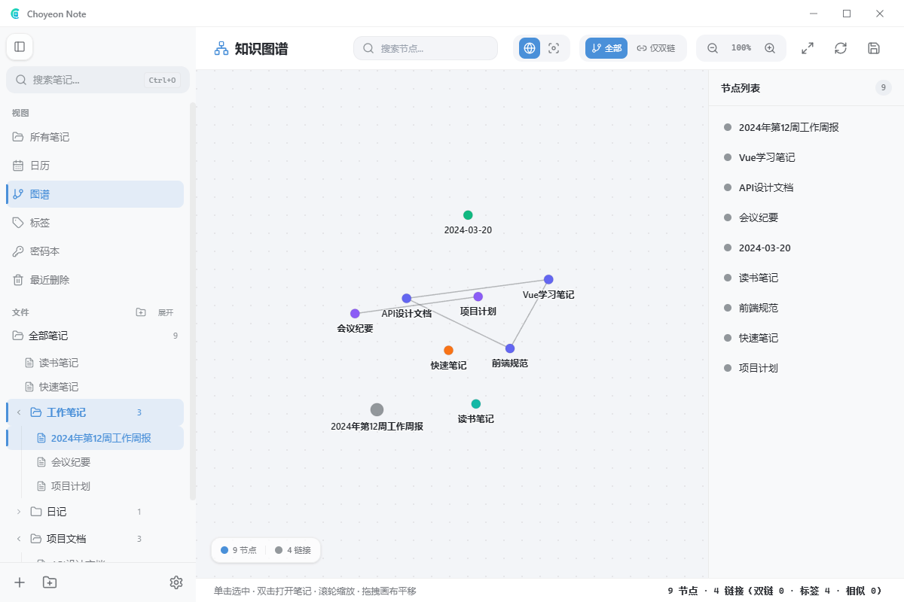
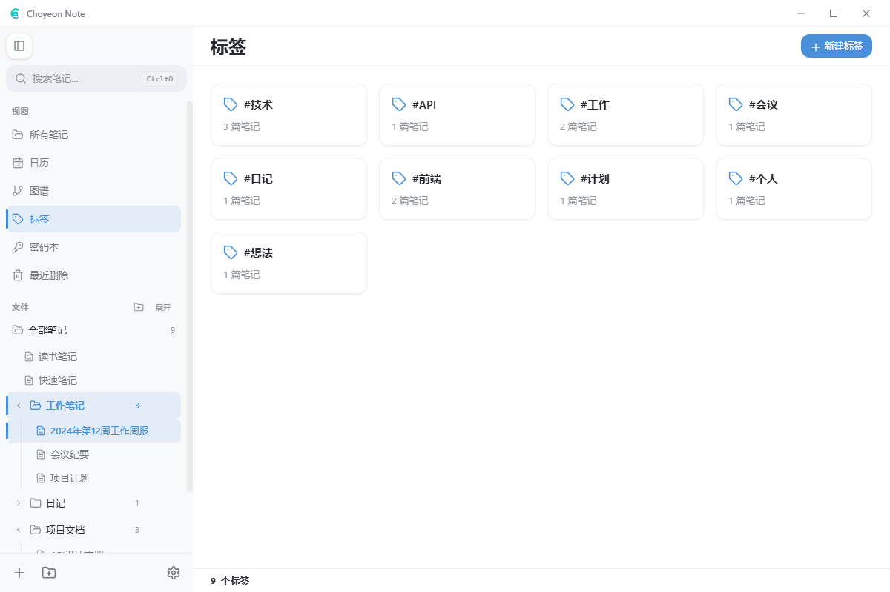
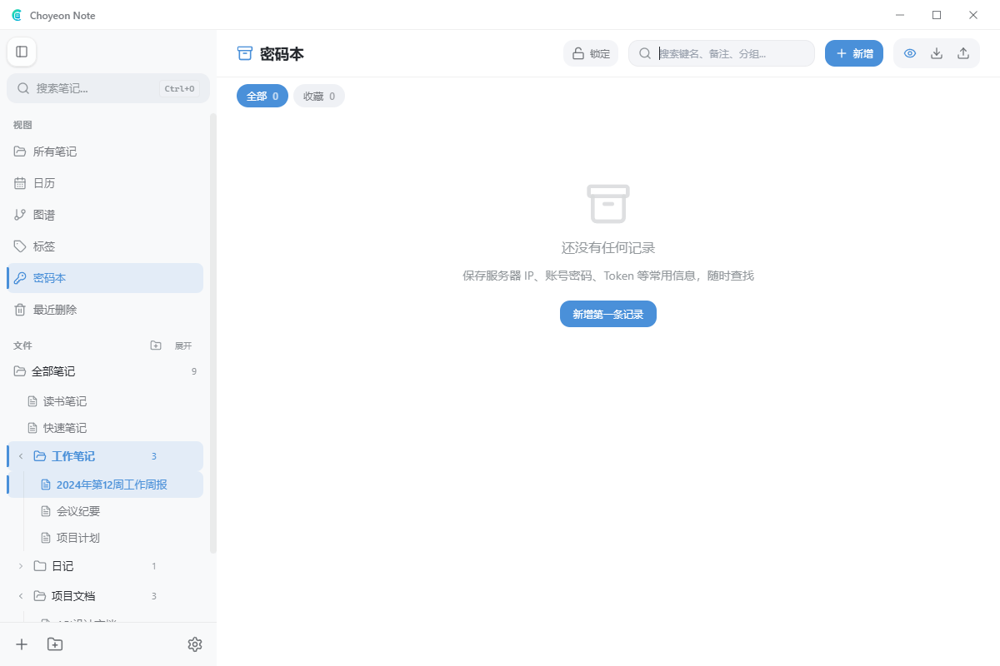
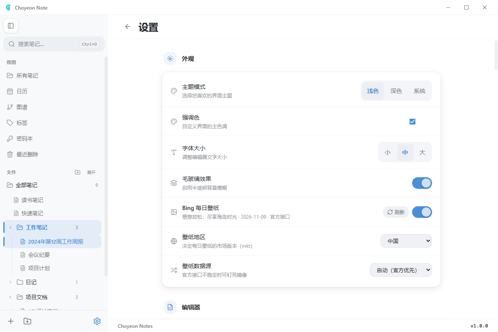
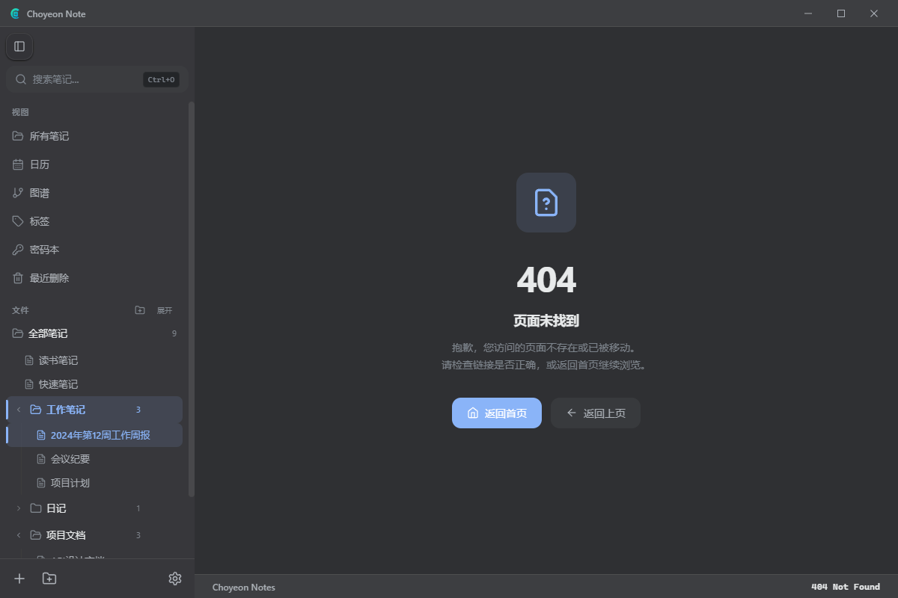
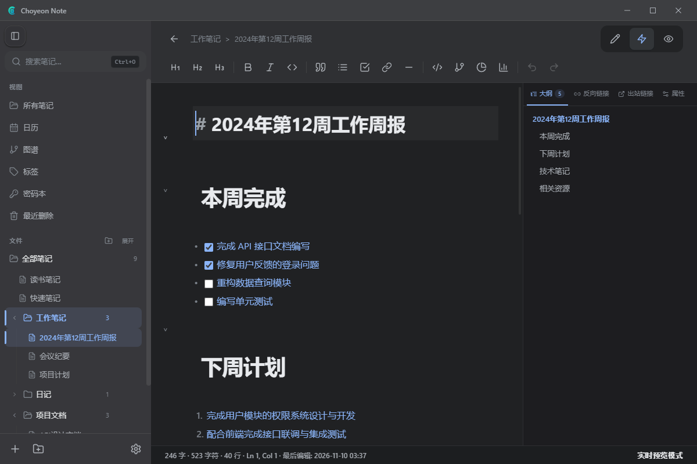
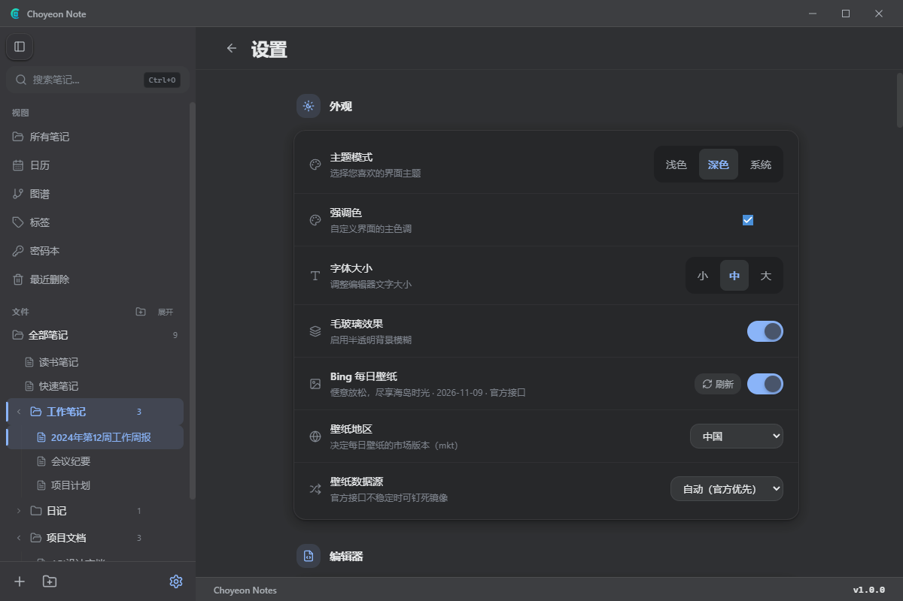

# Choyeon Note

[](https://tauri.app/)
[](https://www.rust-lang.org/)
[](https://vuejs.org/)
[](LICENSE)
[](https://github.com/Choyeon/choyeon-note/releases)

**Choyeon Note** 是一款基于 Tauri 2 与 Vue 3 的桌面 Markdown 笔记应用。它以你选择的本地目录作为笔记库，提供 CodeMirror 6 编辑器、Obsidian 风格的双向链接与本地文件管理能力——**笔记就是你目录里的 `.md` 文件，永远不锁死在任何数据库里**。

> 想要先看看长什么样？往下翻就是实拍界面预览 👇

---

## 🖼️ 界面预览

所有截图均为应用真实运行画面（浅色 / 暗色两套主题，毛玻璃侧栏与顶栏）。

### 浅色主题

<table>
  <tr>
    <td></td>
    <td></td>
  </tr>
  <tr>
    <td></td>
    <td></td>
  </tr>
  <tr>
    <td></td>
    <td></td>
  </tr>
  <tr>
    <td></td>
    <td></td>
  </tr>
</table>

### 暗色主题

<table>
  <tr>
    <td></td>
    <td></td>
  </tr>
  <tr>
    <td></td>
    <td></td>
  </tr>
</table>

---

## ✨ 为什么选择 Choyeon Note

- **文件即笔记**：直接读写你选的本地目录，支持嵌套文件夹与 `.md` / `.markdown` / `.txt`。换电脑、上 Git、丢进 Obsidian，都能无缝接管。
- **三种编辑器模式**：源码编辑、Obsidian 风格实时预览、沉浸式阅读预览，三者共享同一份文档与撤销栈。
- **知识网络**：`[[双向链接]]`、`#标签`、独立**知识图谱**视图，把零散笔记连成网。
- **本地优先**：密码本、工作空间配置留在应用私有目录，绝不污染你的笔记库。
- **好看且能调**：浅色 / 暗色 / 跟随系统，毛玻璃质感、可配置强调色、字号与编辑器缩放。

---

## 功能特性

### 编辑与渲染

- 源码编辑、实时预览、阅读预览三种编辑器模式。
- 支持 GFM Markdown、表格、任务列表、代码块与常用格式化命令。
- 支持 `[[笔记名]]`、`[[笔记名|别名]]`、`![[嵌入]]`、Callout、YAML Frontmatter 与 `#标签`。
- Mermaid 图表按需加载；代码块使用 Highlight.js 的常用语言精简集和 6 套内置主题。
- 编辑器右栏提供大纲、反向链接、出站链接和 Frontmatter 属性编辑。
- 英文拼写检查支持纠错建议、忽略词和自定义词典。

### 笔记与工作空间

- 选择本地目录作为工作空间，并管理多个最近工作空间。
- 识别 `.md`、`.markdown` 和 `.txt` 笔记文件。
- 文件夹树支持创建、重命名、删除和拖放移动笔记或文件夹。
- 提供笔记列表（列表 / 卡片与排序）、全文搜索、快速跳转和命令面板。
- 提供日历、知识图谱、标签、独立阅读和密码本视图。
- 支持自动保存、笔记目录变更监听和 GitHub Releases 自动更新。

### 知识组织

- **知识图谱**：以双链为主边、标签相似度为辅，自动排布节点；支持缩放居中。
- **日历**：按天聚合笔记，点击日期查看当日笔记卡片。
- **标签**：汇总全部 `#标签`，按使用频率浏览与筛选。

### 外观与设置

- 浅色、深色和跟随系统主题，可配置强调色、字号、编辑器缩放与毛玻璃效果。
- 可选 Bing 每日壁纸。
- 可在设置页搜索、修改、清除或恢复快捷键，并检测同作用域冲突。
- 密码本支持分类、搜索、收藏、CSV 导入导出和自动锁定；系统安全存储可用时会加密敏感值。

---

## 安装与运行

### 方式一：下载安装包（推荐）

前往 [GitHub Releases](https://github.com/Choyeon/choyeon-note/releases) 页面，下载对应平台的最新安装包：

- **Windows**：Tauri 生成的 `.msi` / `.exe` 安装包（由 `npm run tauri:build:win` 产出）。
- **macOS / Linux**：当前官方 Release 仅提供 Windows 安装包；其它平台需从源码构建。
- 安装包未做代码签名，Windows SmartScreen 首次运行可能提示“未知发布者”，请核对发布者 `Choyeon` 与仓库地址后继续。
- 应用内检测到新版本时会通过 GitHub Releases 自动提示更新。

### 方式二：从源码构建

环境要求与安装步骤见下文。

#### 环境要求

- **Node.js 22.12.0 或更高版本**（Vite 8 要求 `^20.19.0 || >=22.12.0`）。
- **Rust 1.77.2 或更高版本**，以及对应平台的 C/C++ 链接工具链（Windows 需 MSVC Build Tools 或 MinGW-w64）。
- npm（随 Node.js 安装）。

#### 安装依赖

```bash
npm install
```

#### 开发 / 构建脚本

`package.json` 提供以下全部脚本：

| 命令 | 用途 |
|---|---|
| `npm run dev` | 启动 Vite 前端开发服务器；不启动桌面窗口。 |
| `npm run build` | 构建前端资源到 `dist/`。 |
| `npm run preview` | 使用 Vite 本地预览已构建的前端资源，通常先运行 `npm run build`。 |
| `npm run tauri:dev` | 并行启动 Vite 与 Tauri 桌面窗口（推荐的开发方式）。 |
| `npm run tauri:build` | 构建前端并打包当前平台的 Tauri 安装包。 |
| `npm run tauri:build:win` | 构建 Windows x64（GNU 目标）的 Tauri 安装包。 |
| `npm run generate:icons` | 从 `build/icons/source.png` 生成多尺寸 PNG 和 Windows ICO；也可在命令末尾通过 `-- <源图片路径>` 指定输入。 |
| `npm test` | 以单次运行模式执行 Vitest 测试套件。 |

---

## 快速上手

1. 启动应用后，在**欢迎页**点击「试用示例」即可用内置示例笔记快速体验；或选择「打开文件夹」将任意本地目录作为笔记库。
2. 左侧栏切换视图：所有笔记、日历、图谱、标签、密码本、最近删除。
3. 双击笔记进入编辑器；右上角在「编辑 / 实时预览 / 阅读预览」三种模式间切换。
4. 在设置页调整主题、强调色、字号、毛玻璃与壁纸，并管理快捷键与密码本。

---

## 技术栈

| 层 | 技术 |
|---|---|
| 桌面运行时 | Tauri `2` + Rust（WebView2 / WKWebView / WebKitGTK） |
| 前端框架 | Vue `^3.4.0` + Composition API |
| 路由 | Vue Router `^4.2.5` |
| 状态管理 | Pinia `^2.1.7` |
| 编辑器 | CodeMirror 6 |
| Markdown | marked `^11.1.0` + DOMPurify `^3.4.13` |
| 语法高亮 | Highlight.js `^11.11.1`（常用语言精简集） |
| 图表 | Mermaid（版本以 `package.json` 为准） |
| 拼写检查 | 自研 `src/utils/spellcheck.js` + `src/utils/dictionary.js` 英文词库 |
| 样式 | Tailwind CSS `^3.4.0` + PostCSS + Autoprefixer |
| 构建 | Vite `^8.2.0` |
| 测试 | Vitest（版本以 `package.json` 为准）+ jsdom |
| 打包与更新 | Tauri Bundler + GitHub Releases（Rust 侧检查与下载） |
| 图标处理 | sharp `^0.35.3` + ICO 容器生成脚本 |

---

## 项目结构

```text
choyeon-note/
├── build/
│   └── icons/                    # 应用图标与生成结果
├── src-tauri/
│   ├── src/
│   │   ├── fs_commands.rs        # 文件系统与路径安全
│   │   ├── trash.rs              # 系统回收站 + 库内 .trash
│   │   ├── watch.rs              # 笔记目录增量监听
│   │   ├── logging.rs            # main.log 落盘与轮转
│   │   ├── settings.rs           # 工作空间 / 映射表 / 密码本
│   │   ├── system.rs             # 窗口、菜单、壁纸与更新
│   │   └── state.rs              # 应用状态与路径兼容
│   ├── capabilities/             # WebView 权限声明
│   ├── icons/                    # 各平台应用图标
│   └── tauri.conf.json           # 窗口、构建与打包配置
├── public/                       # 静态资源
├── scripts/
│   └── generate-icons.js         # 多尺寸 PNG / ICO 生成
├── src/
│   ├── assets/
│   │   └── code-themes/          # 6 份内置 Highlight.js 主题 CSS
│   ├── components/
│   │   └── editor/               # 编辑器工具栏、侧栏、右栏与拼写菜单
│   ├── composables/              # 编辑器、命令、链接与拖放逻辑
│   ├── constants/
│   │   ├── noteFile.js           # 笔记扩展名白名单
│   │   ├── sampleNotes.js        # 示例笔记
│   │   ├── shortcuts.js          # 快捷键单一数据源
│   │   └── storage.js            # localStorage key 与配置 schema
│   ├── router/
│   │   └── index.js              # 页面路由与工作空间守卫
│   ├── stores/                   # Pinia 应用、笔记、工作空间与密码本状态
│   ├── utils/
│   │   ├── editor/               # CodeMirror 命令、主题、实时预览与拼写扩展
│   │   ├── dictionary.js          # 英文词库
│   │   ├── markdown.js           # Markdown、Obsidian 语法与 Mermaid 渲染
│   │   ├── noteIndex.js          # 双链、标签与大纲索引
│   │   ├── spellcheck.js         # 拼写检查与纠错建议
│   │   └── tauriBridge.js        # Tauri → electronAPI 兼容层（渲染层零改动）
│   ├── views/
│   │   └── settings/             # 词典与快捷键设置子组件
│   ├── App.vue
│   ├── main.js
│   └── style.css
├── tests/
│   ├── fixtures/
│   │   └── legacy-electron/      # 旧主进程源码快照，仅作测试夹具
│   └── *.test.js                 # Vitest 测试
├── index.html
├── package.json
├── package-lock.json
├── postcss.config.js
├── tailwind.config.js
├── vite.config.js
├── README.md
└── LICENSE
```

`src/assets/code-themes/` 中的主题以 `?raw` 方式打包。它们不直接从 `node_modules` 引用，是为了避免生产构建后相对路径失效，并保证实时预览与阅读预览使用同一套高亮样式。

---

## 键盘快捷键

快捷键的单一数据源是 `src/constants/shortcuts.js`。`Mod` 在 Windows / Linux 上表示 `Ctrl`，在 macOS 上表示 `Cmd`；用户自定义后以设置页显示的当前绑定为准。下表列出源码中的全部默认值，“隐藏”项是内部备选绑定，不在设置页列表中显示。

| 分类 | 功能 | 作用域 | 默认绑定 | 备注 |
|---|---|---|---|---|
| 文件与工作空间 | 新建笔记 | 应用 | `Mod-n` |  |
| 文件与工作空间 | 保存笔记 | 应用 | `Mod-s` |  |
| 文件与工作空间 | 快速跳转 | 应用 | `Mod-o` |  |
| 文件与工作空间 | 命令面板 | 应用 | `Mod-Shift-p` |  |
| 文件与工作空间 | 密码本 | 应用 | `Mod-Shift-v` |  |
| 文件与工作空间 | 打开设置 | 应用 | `Mod-,` |  |
| 编辑 | 撤销 | 编辑器 | `Mod-z` |  |
| 编辑 | 重做 | 编辑器 | `Mod-y` |  |
| 编辑 | 重做（备选） | 编辑器 | `Shift-Mod-z` | 隐藏 |
| 编辑 | 全选 | 编辑器 | `Mod-a` |  |
| 编辑 | 增加缩进 | 编辑器 | `Tab` |  |
| 编辑 | 减少缩进 | 编辑器 | `Shift-Tab` |  |
| 编辑 | 上移当前行 | 编辑器 | `Alt-ArrowUp` |  |
| 编辑 | 下移当前行 | 编辑器 | `Alt-ArrowDown` |  |
| 编辑 | 复制当前行 | 编辑器 | `Shift-Mod-d` |  |
| 编辑 | 删除当前行 | 编辑器 | `Mod-Shift-k` |  |
| 编辑 | 下方插入空行 | 编辑器 | `Mod-Enter` |  |
| 编辑 | 切换待办状态 | 编辑器 | `Mod-Enter` | 隐藏 |
| 格式化 | 加粗 | 编辑器 | `Mod-b` |  |
| 格式化 | 斜体 | 编辑器 | `Mod-i` |  |
| 格式化 | 下划线 | 编辑器 | `Mod-u` |  |
| 格式化 | 高亮 | 编辑器 | `Mod-Shift-h` |  |
| 格式化 | 删除线 | 编辑器 | `Mod-Shift-x` |  |
| 格式化 | 行内代码 | 编辑器 | `Mod-e` |  |
| 格式化 | 链接 | 编辑器 | `Mod-k` |  |
| 格式化 | 一级标题 | 编辑器 | `Mod-Alt-1` |  |
| 格式化 | 二级标题 | 编辑器 | `Mod-Alt-2` |  |
| 格式化 | 三级标题 | 编辑器 | `Mod-Alt-3` |  |
| 格式化 | 四级标题 | 编辑器 | `Mod-Alt-4` |  |
| 格式化 | 引用 | 编辑器 | `Mod-Shift-b` |  |
| 格式化 | 无序列表 | 编辑器 | `Mod-Shift-8` |  |
| 格式化 | 有序列表 | 编辑器 | `Mod-Shift-7` |  |
| 格式化 | 待办列表 | 编辑器 | `Mod-Shift-9` |  |
| 插入 | 代码块 | 编辑器 | `Mod-Alt-c` |  |
| 插入 | 分隔线 | 编辑器 | `Mod-Alt--` |  |
| 插入 | 插入当前日期 | 编辑器 | `Mod-Shift-d` | 隐藏 |
| 插入 | 插入双链 `[[]]` | 编辑器 | `Mod-Shift-l` |  |
| 视图与导航 | 切换侧边栏 | 应用 | `Mod-\` |  |
| 视图与导航 | 切换阅读模式 | 编辑器 | `Mod-Shift-e` |  |
| 视图与导航 | 切换实时预览 | 编辑器 | `Mod-Shift-l` | 隐藏 |
| 视图与导航 | 关系图谱 | 应用 | `Mod-Shift-g` |  |
| 视图与导航 | 日历视图 | 应用 | `Mod-Shift-c` |  |
| 视图与导航 | 搜索笔记 | 应用 | `Mod-Shift-f` |  |
| 视图与导航 | 切换明暗主题 | 应用 | `Mod-Shift-t` |  |

---

## 数据存储说明

- **笔记正文**：直接读写用户选择的工作空间目录，支持嵌套文件夹以及 `.md`、`.markdown`、`.txt` 文件。应用不会把笔记正文放进数据库。
- **界面与编辑器配置**：保存在渲染进程 `localStorage`，键统一使用 `choyeon-` 前缀；集中定义的配置键见 `src/constants/storage.js`，当前笔记、最近访问与最近搜索等状态也沿用该前缀。
- **应用数据**：Tauri 复用旧版 Electron 的 `userData` 目录，当前工作空间写入 `userData/settings.json`，工作空间列表写入 `userData/workspaces.json`，拼写忽略词和自定义词典写入 `userData/spell-data.json`，升级后原有配置不丢失。
- **密码本**：桌面环境下按工作空间写入 `userData/vaults/<workspaceId>.json`，不会混入笔记目录；敏感值使用操作系统凭据库加密（Windows DPAPI）。纯浏览器预览环境仅使用 `choyeon-kv-vault` 作为后备存储。

---

## 已知限制

- 当前未实现数学公式或 KaTeX 渲染，`$...$` 与 `$$...$$` 不会被渲染为公式。
- 拼写检查基于内置英文词库，仅检查英文单词；中文分词与中文拼写纠错不在当前能力范围内。
- Highlight.js 使用约 40 种常用语言的精简集，而不是完整语言包；未收录语言会退化为自动检测或纯文本显示。
- Tauri 无边框窗口不显示原生菜单栏；与原 Electron 版本视觉一致，所有操作仍可通过快捷键与命令面板完成。
- `npm run dev` 只启动浏览器中的前端，无法提供桌面文件系统、系统安全存储和自动更新能力；完整桌面开发请使用 `npm run tauri:dev`。
- 密码本依赖操作系统凭据库。在非 Windows 平台上当前不提供系统级加密，界面会显示相应提示。

---

## 许可证

本项目采用 [MIT License](LICENSE)，版权所有 © 2026 Choyeon。
